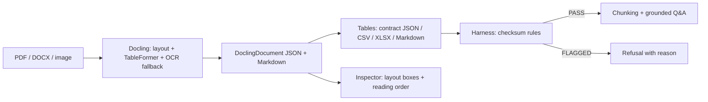

# Layout-Aware Document Intelligence & Table Structure Reconstruction with IBM Docling

DS1 Project 20. A Python pipeline that converts complex documents (digital PDFs, scanned PDFs,
images, Word files) into **structured, verified tables**, shows how the document layout was
understood, and answers questions **only** from tables that passed deterministic checks.

## Problem and objectives

Tables in reports and invoices are easy for humans to read but hard for software: multi-column
layouts, merged cells, scanned pages and OCR errors all produce tables that *look* plausible but
contain wrong numbers. A question-answering system built on such tables can confidently return a
wrong value.

Objectives:

1. Convert documents with IBM Docling (layout analysis + TableFormer table structure + OCR).
2. Export every table to machine-readable formats (DataFrame, CSV, JSON, Markdown, Excel).
3. Verify each table with deterministic checksum rules (row totals, column totals, structure).
4. Visualise the detected layout (bounding boxes, reading order) to explain the result.
5. Automate the pipeline and answer questions only from verified tables, refusing otherwise.

## Main features

| Feature | Where |
|---|---|
| Docling conversion with an automatic retry cascade (fast → accurate → OCR + accurate) | `engine/convert.py` |
| Scanned PDFs and images (PNG / JPG / TIFF) handled through OCR | `engine/convert.py` |
| Table export to CSV, JSON, Markdown and Excel; number cleaning (`1 234,56`, `1.234.567`, `(120)`, `$40`) | `engine/export.py`, `engine/contract.py` |
| Checksum harness (Pydantic v2): row / column totals, empty cells, ragged rows, text in numeric columns, merged-layout detection → **PASS** or **FLAGGED** with a reason | `harness/` |
| Streamlit inspector: upload and convert, page image with layout boxes and reading order, tables with verdicts, downloads, Q&A | `inspector/` |
| FastAPI service with Swagger docs | `api/` |
| Chunking (Docling HybridChunker, Markdown fallback), BM25 retrieval, grounded extractive answers with citations, refusal on flagged tables | `qa/` |
| Watch-folder automation: drop a file → convert → verdict → answer or refusal | `automation/` |
| Baseline comparison with pdfplumber, digital vs scanned comparison | `baseline/` |

## Technologies

Python 3.12 · IBM Docling 2.151.1 (layout model, TableFormer, OCR) · pandas · Pydantic v2 ·
FastAPI + Uvicorn · Streamlit · pypdfium2 + Pillow (page rendering) · openpyxl (Excel) ·
watchdog (watch-folder) · pdfplumber (baseline) · pytest.

## Architecture



```
engine/        conversion (convert.py), number cleaning (contract.py), layout boxes (boxes.py), exports (export.py)
harness/       checksum rules (checks.py), Pydantic models (models.py), CLI (validate.py)
inspector/     Streamlit app (app.py) and page rendering (overlay.py)
api/           FastAPI application
qa/            chunking, retrieval, grounded answering
automation/    watch_folder.py, inbox/ (files in), results/ (API responses out, generated)
baseline/      pdfplumber baseline, comparison report, digital-vs-scan comparison
samples/       9 sample documents used in the demo
fixtures/      5 hand-written tables (2 valid, 3 broken) for the harness tests
demo/          hand-written engine-shaped data for the API / Q&A tests (not Docling output)
tests/         pytest suite
docs/          project brief (kept locally, never published: see .gitignore)
screenshots/   screenshots of the running app for the slides and the submission
make_samples.py   regenerates the 4 generated sample PDFs
*.bat             Windows helpers (setup, tests, inspector, API, watch-folder, full comparison)
```

Every table is stored in one JSON contract shared by all components:

```json
{"doc_id": "sample_simple_table", "table_id": "sample_simple_table_p1_t1", "page": 1,
 "columns": ["Item", "Q1", "Q2", "Q3", "Total"],
 "rows": [["Laptops", 120, 135, 150, 405], ["Total", 400, 410, 440, 1250]]}
```

## Installation (Windows)

Requirements: Python 3.10+ (3.12 recommended), about 5 GB of free disk, internet on the first run
(Docling downloads its models once).

```powershell
cd "C:\path\to\project"
setup.bat full        # creates .venv, installs requirements.txt, runs the tests
```

`setup.bat` without `full` installs the light requirements (`requirements-api.txt`): API, Q&A,
harness, inspector and tests, **without** Docling. Real conversion then needs the full install.

Manual alternative:

```powershell
py -3.12 -m venv .venv
.venv\Scripts\Activate.ps1          # cmd.exe: .venv\Scripts\activate.bat
python -m pip install --upgrade pip
pip install -r requirements.txt
```

## How to run

Activate the environment first (`.venv\Scripts\Activate.ps1`), from the project folder.

| Goal | Command |
|---|---|
| Convert one file or a whole folder | `python -m engine.convert samples\sample_simple_table.pdf --out output` (options: `--accurate`, `--ocr`, `--no-fallback`) |
| Validate the extracted tables | `python -m harness.validate output` |
| Inspector (Streamlit) | `run_inspector.bat` → http://localhost:8501 |
| API | `run_api.bat` → Swagger at http://127.0.0.1:8000/docs (`run_api.bat demo` uses the demo data, no Docling needed) |
| Watch-folder | `run_api.bat` in one window, `run_watch.bat "What is the total?"` in another, then copy a file into `automation\inbox\` |
| Q&A from the command line | `python -m qa.demo --root output --question "What is the total?" --doc-id sample_simple_table` |
| Docling vs pdfplumber comparison | `run_all.bat` (converts every sample: slow) |
| Digital vs scanned invoice | `python -m baseline.compare_digital_vs_scan` |

Outputs per document in `output\<doc_id>\`: `<doc_id>.md`, `<doc_id>.docling.json`,
`summary.json` (attempts, mode, status) and `tables\<table_id>.json` / `.csv`.
The inspector also offers JSON, CSV, Markdown and Excel downloads for each table.

## Tests

```powershell
run_tests.bat            # or: python -m pytest -q
```

With Docling installed, every test passes. On the light install the tests that run the real Docling
models (`tests/test_real_docling.py` and two in `test_robustness.py`) are skipped.

## Samples and demo

| Sample | Shows | Expected result |
|---|---|---|
| `sample_simple_table.pdf` | clean table with totals | 1 table, **PASS**; "What is the total?" → `1250`, page 1 |
| `sample_wrong_total.pdf` | printed total is wrong | **FLAGGED** (`ROW_TOTAL_MISMATCH`, `COLUMN_TOTAL_MISMATCH`: 1250 ≠ 1300); question **refused** |
| `sample_two_column_table.pdf` | two-column page layout | 1 table, PASS; reading order visible in the inspector |
| `sample_wrong_total_long_title.pdf` | failure case kept on purpose | 0 tables → `no_tables` warning |
| `invoice_zoho.pdf` | real digital invoice | 3 tables |
| `scan_invoice.pdf` | the same invoice, scanned | cascade `fast = 0 usable`, `accurate = 0 usable`, `OCR + accurate = 3 usable` |
| `scan_invoice.jpeg` | the same invoice as an image | OCR conversion; messy table, flagged (see limitations) |
| `annual_report_biat_2024.pdf` | 33-page real annual report | 40 tables, about 5 minutes to convert |
| `report_docling_paper.pdf` | multi-column scientific paper | layout and reading-order showcase (slow to convert) |

Suggested demo: convert the samples beforehand, open the inspector, show the layout boxes, a
PASS table and a FLAGGED table with its reason, ask the same question on both (answer vs refusal),
then drop the two sample PDFs into the watch-folder.

## Limitations

- The harness checks **arithmetic consistency**, not fidelity to the page: a table without any
  Total row or column only passes structural checks (shown as "PASS (structure only)").
- Invoice summary blocks (Sub Total / Tax / Total) have no header row; Docling uses the first line
  as header and the column-sum rule flags the table. This errs on the safe side (refusal).
- On `scan_invoice.jpeg` the layout model merges most of the page into one table; the scanned PDF
  of the same invoice gives clean tables.
- The Q&A is rule-based and extractive (no LLM is connected); it supports cell, total and simple
  aggregate questions on verified tables.
- The `--vlm` (vision-model) option exists but has not been tested.
- Local academic demo: the API has no authentication; do not expose it to an untrusted network.

More detail: [`api/README.md`](api/README.md), [`qa/README.md`](qa/README.md),
[`harness/README.md`](harness/README.md), [`inspector/README.md`](inspector/README.md),
[`automation/README.md`](automation/README.md).
Docling: https://github.com/docling-project/docling
