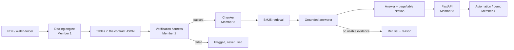
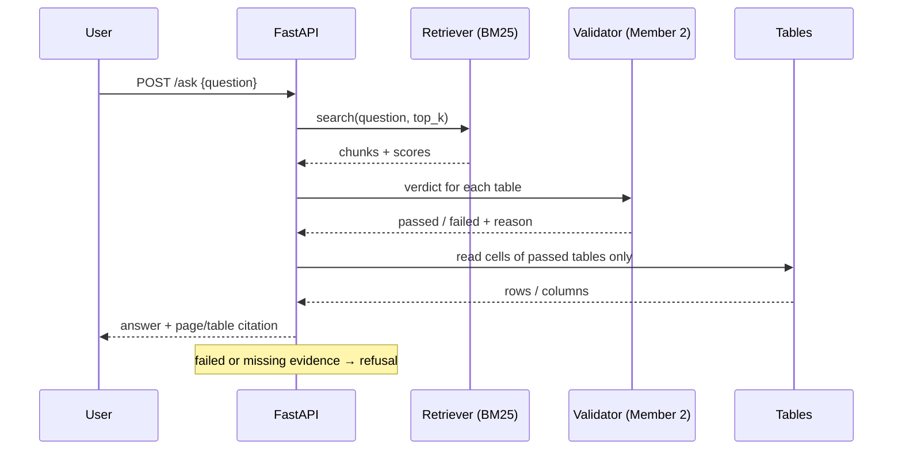

# Member 3 — slide guide (chunking, RAG, grounding, FastAPI)

This is a **speaker guide + Mermaid source**, not a finished PowerPoint. The professor
requires diagrams drawn by the team: redraw the Mermaid diagrams yourself in PowerPoint
(or on paper and photograph them), and run every command before showing it. Do not claim
that the HybridChunker path was executed on a machine where Docling was not installed.

## Slide 1 — Where Member 3 sits

**Title:** From verified tables to answers that can be defended

Architecture (redraw it):



Speaker notes:

* Member 1 extracts, Member 2 verifies, Member 3 answers only from verified tables.
* The refusal branch is part of the design, not an error.
* `GET /health` exposes which chunker actually ran.

## Slide 2 — What a chunk is here

**Title:** A chunk must carry its evidence

Definition: a chunk is the smallest unit sent to retrieval. For this project it must carry
`doc_id`, `page`, `table_id` and `validation_status`.

```json
{
  "chunk_id": "sales_2026:table:sales_2026_p1_t1",
  "doc_id": "sales_2026",
  "page": 1,
  "table_id": "sales_2026_p1_t1",
  "kind": "table",
  "validation_status": "passed",
  "table_columns": ["Item", "Q1", "Q2", "Q3", "Total"],
  "table_rows": [["Laptops", 120, 135, 150, 405], ["..."]]
}
```

Speaker notes:

* Table chunks keep the structured rows next to the text, so the answerer never parses
  Markdown to recover a number.
* Text chunks carry `validation_status = not_applicable`; they are context, not a source of
  numeric answers.
* Page numbers are never invented: table page comes from the contract, text page comes from
  a `<!-- page: N -->` marker, otherwise `null`.

## Slide 3 — Chunking strategies

**Title:** Fixed-size vs structure-aware chunking

| Strategy | How it splits | Risk |
|---|---|---|
| Fixed-size character/token windows | every N characters | cuts a table row or a sentence in half |
| Paragraph/section | on blank lines/headings | a long paragraph can exceed the token budget |
| **HybridChunker** | uses the document structure and token budget | needs Docling's document model and a tokenizer |

Speaker notes:

* A table split in the middle is dangerous: the answerer may sum a fragment.
* Our table chunks are one per table (split only for very long tables), and the answerer
  loads the full contract table for aggregation, not the fragment.
* `HybridChunker` is Docling's structure-aware chunker; see
  https://docling-project.github.io/docling/concepts/chunking/

## Slide 4 — HybridChunker path (implemented, not executed here)

**Title:** Chunking a DoclingDocument

Steps implemented in `qa/chunking.py`:

1. Reload `<doc_id>.docling.json` as a `DoclingDocument` (`model_validate_json`).
2. Re-walk `doc.tables` to reproduce Member 1's `table_id` numbering.
3. Map each chunk's `doc_items` (`self_ref`) to a `table_id`.
4. Read page provenance from `doc_items[*].prov[*].page_no`.
5. Attach the Member 2 verdict as `validation_status`.

Honesty note for the slide:

> The HybridChunker code path is implemented, but on the test machine Docling was not
> installed, so the verified run used the Markdown fallback. `GET /health` reports
> `chunking_method` per document.

The fallback is deterministic and testable: Markdown paragraphs + one chunk per contract
table.

## Slide 5 — RAG in one picture

**Title:** Retrieval-augmented generation, with a gate



Definitions:

* **Retrieval:** rank chunks by relevance to the question.
* **Augmentation:** put the retrieved evidence in front of the answer step.
* **Generation:** produce an answer; here the default generator is extractive and
  deterministic, with an optional LLM behind a number-grounding gate.

Sources: Lewis et al., *Retrieval-Augmented Generation for Knowledge-Intensive NLP Tasks*
(2020), https://arxiv.org/abs/2005.11401

## Slide 6 — Retrieval choice: BM25 first

**Title:** Why no embeddings by default?

| Criterion | BM25 (used) | Dense embeddings |
|---|---|---|
| Extra download / API key | none | model or provider |
| Determinism | exact scores, reproducible | model/version dependent |
| Table questions (`Laptops`, `Q1`) | strong lexical match | strong, but unnecessary |
| Synonyms / paraphrases | weak | strong |

Speaker notes:

* The project values reproducibility and zero external dependencies for the demo.
* BM25 is implemented in ~100 lines (`qa/retrieval.py`) and unit-tested.
* Embeddings are a documented extension, not a hidden claim.
* BM25 source: Robertson & Zaragoza (2009),
  https://doi.org/10.1561/1500000019

## Slide 7 — Grounding and citation

**Title:** What "grounded" means in this project

A grounded answer satisfies all four:

1. It uses at least one table whose verdict is `passed`.
2. It quotes a cell, row, column or a deterministic aggregate from that table.
3. It cites `doc_id`, `page` and `table_id`.
4. Every number in the answer body is present in the table or was computed by the
   deterministic path; otherwise the system refuses.

The grounding check:

```python
allowed = {all numeric cells of the table} | {computed values}
unmatched = [n for n in numbers_in_text(answer_body) if n not in allowed]
if unmatched:
    refuse()
```

`Q1`, `sales_2026_p1_t1` and page numbers are identifiers, not values; the regex uses
word-boundary guards so they are not treated as evidence.

## Slide 8 — Why unvalidated tables cause wrong answers

**Title:** A plausible table can still be wrong

Demo table (`broken_budget`):

| Item | Q1 | Q2 | Total |
|---|---:|---:|---:|
| A | 10 | 20 | 30 |
| B | 5 | 5 | 10 |
| Total | 15 | 25 | **99** |

The harness catches it:

* row Total: `15 + 25 = 40`, not `99`;
* column Total: `30 + 10 = 40`, not `99`.

If the Q&A layer ignored the verdict, it could answer "the total is 99" with a confident
citation. The refusal is the correct outcome:

```json
{"refused": true, "used_table_ids": ["broken_budget_p2_t1"],
 "warnings": ["... ROW_TOTAL_MISMATCH ..."]}
```

This is the professor's harness requirement applied to RAG: AI output is data, not truth.

## Slide 9 — FastAPI's role

**Title:** A small, typed service between the workflow and the Q&A engine

| Endpoint | Why it exists |
|---|---|
| `POST /convert` | Member 4's automation sends a file |
| `GET /tables/{id}` | show the table, the verdict and `usable` |
| `POST /ask` | grounded answer or refusal |
| `POST /reload` | re-scan after an external engine run |
| `POST /validate` | expose Member 2's pass rates |
| `GET /health` | Docling availability + chunking method |

Why FastAPI:

* Pydantic v2 request/response models give validation and OpenAPI docs for free;
* `/docs` is a live, testable contract for Member 4 and the professor;
* sync endpoints run in a threadpool, so slow Docling conversion does not block `/ask`.

Source: https://fastapi.tiangolo.com/

## Slide 10 — Demo script (3–5 minutes)

Run these on the demo output (no Docling needed):

```bat
run_demo_api.bat
```

Then:

1. Open http://127.0.0.1:8000/docs.
2. `GET /health` — show `documents=5`, `tables=4`, `tables_passed=3`,
   `docling_available=false`, `chunking_methods=markdown`.
3. `POST /ask` — `What were Laptops sales in Q1?` → `120`, page 1, table
   `sales_2026_p1_t1`.
4. `POST /ask` — `What is the grand total in the sales report?` → `1250`.
5. `GET /tables/broken_budget_p2_t1` — `usable: false`, both mismatch codes.
6. `POST /ask` — `What is the total in the broken budget?` → `refused: true` with reason.
7. `POST /ask` — `What does the scanned report say?` with
   `doc_id: "scanned_report"` → refusal because 0 tables is a failure.
8. `POST /validate` — `3/4` tables, `3/5` documents.

Screenshot these responses; the JSON is the evidence.

## Slide 11 — What was actually run

**Title:** Test status (2026-11-22, Windows, Python 3.12)

| Item | Result |
|---|---|
| Whole project pytest suite | **119 passed, 2 skipped** |
| Member 3 tests | chunking, every answer shape, every refusal, grounding gate, API, fake `/convert` |
| Real HTTP server | uvicorn on `127.0.0.1:8010`: `/health`, `/ask`, `/tables/{id}`, `/validate`, `/openapi.json` |
| HybridChunker | code implemented; **not executed** (Docling not installed) |
| Real Docling output through the API | **not executed here**; documented command with `DOCLING_OUTPUT_DIR=output` |
| Demo corpus | hand-written, **not** Docling output (stated in `demo/docs/README.md`) |

Do not say "HybridChunker was tested" or "Docling output was tested" on this machine.

## Slide 12 — Limits and next steps

* Lexical retrieval misses synonyms; an embedding backend can be added behind the same
  interface.
* The harness verifies arithmetic consistency, not agreement with the source PDF; a
  consistently misread table can pass.
* No authentication/rate limiting: local demo only.
* Next integration step: install Docling, run `python -m engine.convert samples --out
  output`, set `DOCLING_OUTPUT_DIR=output`, verify `chunking_method="hybrid"`, and compare
  the pass rate with the pdfplumber baseline (Member 1's matrix).

## Sources (put these links on the slides)

* Docling docs — https://docling-project.github.io/docling/
* Docling chunking — https://docling-project.github.io/docling/concepts/chunking/
* Docling paper — https://arxiv.org/abs/2408.09869
* RAG — https://arxiv.org/abs/2005.11401
* BM25 — https://doi.org/10.1561/1500000019
* FastAPI — https://fastapi.tiangolo.com/
* Pydantic v2 — https://docs.pydantic.dev/latest/
